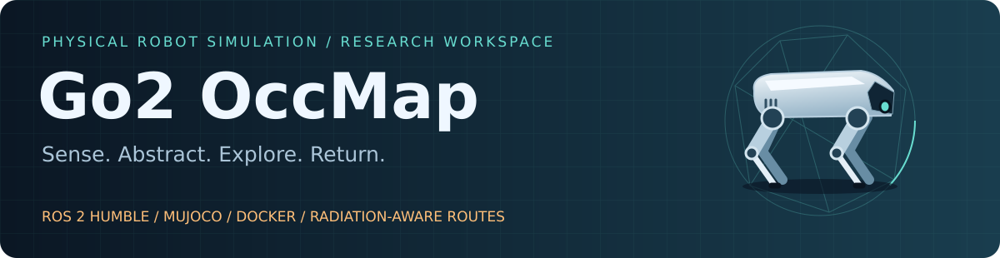
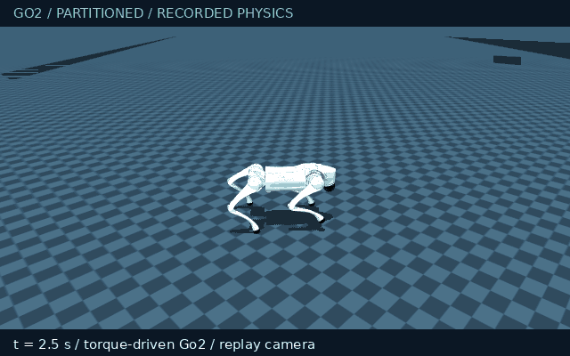
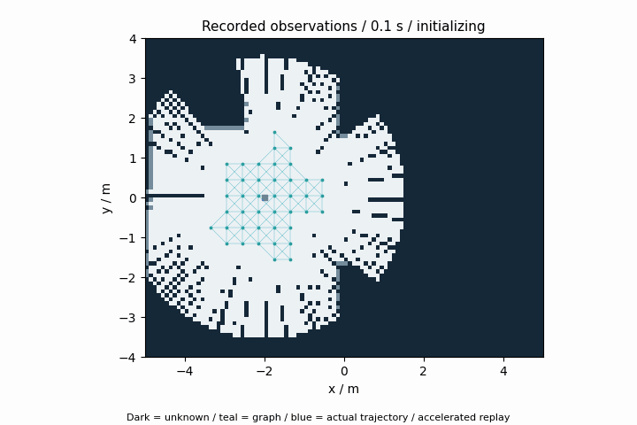
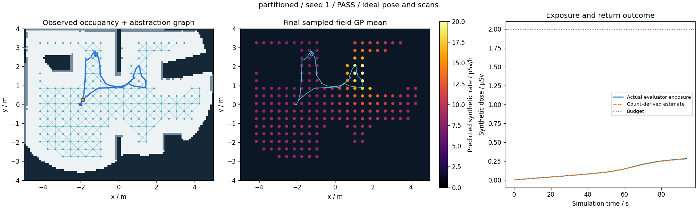

# Go2 Occupancy-Map Abstraction — ROS 2 Workspace



**Unitree Go2 · MuJoCo · ROS 2 Humble · Docker · Radiation-aware graph exploration**

[Quick start](#quick-start) · [Recorded gallery](#recorded-gallery) · [Results](#measured-results) · [Architecture](docs/ARCHITECTURE.md) · [Setup](docs/SETUP.md) · [Verification workflow](.github/workflows/verification.yml)

**Explore an initially unknown room with a physically simulated Go2, turn observed
free space into a sparse navigation graph, and account for estimated radiation
exposure when choosing routes and returning home.**

This workspace now includes two buildable ROS 2 packages, a container runtime,
checksum-pinned public Go2 assets, a walking policy, observed occupancy mapping,
graph exploration, a counting-detector simulation and inspectable run reports.
The default demo runs without a robot, host ROS installation, GPU or display server.

**Repository history:** the published repository previously contained only its
README. The hardware packages described there were not present. This is a **new
self-contained simulation reference**, not a recovered version of those hardware
packages or a reproduction of the complete PhD implementation.
[Hardware status and migration boundary](docs/HARDWARE_STATUS.md).

## Explore the workspace

| Capability | What actually runs |
|---|---|
| **Physical quadruped motion** | Twelve-joint Go2, 200 Hz torque-driven MuJoCo physics and a pinned 50 Hz walking policy |
| **Observed mapping** | Timestamp-matched ideal pose and horizontal scans build a 0.1 m occupancy grid |
| **Occupancy abstraction** | Sampled nodes and collision-checked edges connect inflated, observed free space |
| **Radiation-aware decisions** | Noisy count observations feed a bounded log-Gaussian field estimate and weighted route costs |
| **Return management** | Route exposure, a dose reserve, estimated travel time and a home-tolerance check |
| **ROS integration** | Separate simulator, mapper, explorer and independent DDS interface-monitor processes |
| **Evidence and replay** | Recorded joint/base states, maps, planner traces, exposure, checks and browser reports |

## Quick start

Supported reference host: **x86-64 Linux**, Docker Engine, Docker Compose v2 or
newer, and Python 3 for the launcher. First setup needs internet access and several
GB of disk space. No host ROS or PyTorch installation is needed.

```bash
git clone https://github.com/DavidBatty95/Go2OccMapAbstractionROS2ws.git
cd Go2OccMapAbstractionROS2ws
./go2 setup
./go2 demo --duration 120 --require-return
```

Setup verifies public model/policy downloads under `.cache/go2/`, builds
`go2-occmap:humble`, and uses colcon to install `go2_occmap` and `bringup_go2`.
It does not clone private repositories or require the robot SDK.

The demo is **headless by default**. It runs the ROS/physics loop, writes a unique
directory under `results/`, generates plots and animated replays, and exits
nonzero if its run checks fail. `--require-return` also requires a completed return.
The duration is a maximum in **simulated seconds**; successful missions can finish earlier.

Open the retained report in your browser:

```bash
./go2 results
# Open http://127.0.0.1:8088 and select the new run directory.
```

The browser server binds to loopback. Ctrl+C stops it. [Detailed setup and troubleshooting](docs/SETUP.md).

## Recorded gallery

| Torque-driven Go2 | Observed map and abstraction |
|---|---|
|  |  |

Both panels come from the same retained partitioned-scene, seed-1 run. The left
panel renders recorded MuJoCo states with a following camera. The right replays
recorded occupancy snapshots and trajectory, reconstructing the displayed graph
from those observations. Playback is accelerated; these are not live dashboard
screenshots or evidence of measured real-world performance.

The title graphic is a decorative Go2/graph schematic.
[Media provenance and replay inputs](docs/MEDIA.md).



Dark map areas are unknown. The colored field is the **learned GP mean at graph
nodes**, not the hidden source field. The exposure panel distinguishes the noisy
count-derived dose from independently integrated actual simulated exposure.

## Run experiments

```bash
# A simple room, paced at approximately real time:
./go2 demo --world room --duration 120 --seed 1 --require-return

# Partitioned room, requesting 2x simulation pacing:
./go2 demo --world partitioned --duration 120 --speed 2 --seed 2 --require-return

# Distance-only edge-cost comparison; dose/return constraints remain enabled:
./go2 demo --world partitioned --duration 120 --speed 2 --radiation-weight 0 --require-return

# Interactive MuJoCo and RViz on an authorized X11 display:
./go2 demo --gui --duration 120 --require-return
```

| Option | Default | Meaning |
|---|---:|---|
| `--world` | `partitioned` | `room` or a room with partitions and obstacles |
| `--duration` | `120` | Maximum simulated mission seconds; minimum 15 |
| `--seed` | `1` | Detector-noise seed; geometry does not change |
| `--speed` | `1` | Requested pacing multiplier, 0.1–8; not guaranteed speedup |
| `--dose-budget` | `2` | Synthetic dose-equivalent budget in µSv |
| `--radiation-weight` | `1` | Radiation contribution to graph edge costs; zero makes edges distance-only |
| `--gui` | Off | Open MuJoCo and RViz; requires display access |
| `--require-return` | Off | Include returned-home status in the command's acceptance checks |

Use one command-owning session per DDS domain. `./go2 shell` opens a shell with
the matching ROS configuration. The explorer owns `/cmd_vel`; the ordinary demo
is not a teleoperation session.

## Measured results

**Checkpoint: 7 October 2026.** The final-source cohort contains four runs across
two fixed layouts. All used a 120 s maximum and 2 µSv synthetic budget. The room
run used 1× pacing; the partitioned runs used 2×. No sensor noise other than the
counting-detector noise was introduced.

| Scene | Seed | Edge risk weight | Return time (s) | Travel (m) | Observed free area | Actual dose (µSv) | Obstacle contact steps |
|---|---:|---:|---:|---:|---:|---:|---:|
| Room | 1 | 1 | 94.64 | 14.88 | 86.94% | 0.28719 | 0 |
| Partitioned | 1 | 1 | 93.65 | 13.39 | 78.46% | 0.28275 | 0 |
| Partitioned | 2 | 1 | 98.68 | 14.23 | 78.41% | 0.29054 | 0 |
| Partitioned | 1 | 0 | 89.65 | 14.01 | 76.51% | 0.49488 | 0 |

**4/4 passed the recorded run checks and returned home.** Fifteen unit/physics/interface
tests also passed. An independent subscriber received all twelve monitored ROS
topics with no violations of its checked message contracts.

Coverage is the fraction of ground-truth free raster cells that the observed
map labels free, evaluated after the run. The graph uses only observations.
These trials are an integration checkpoint, not statistical proof of safety,
full facility coverage or a matched-coverage dose-reduction study. The weight-0
comparison still uses radiation-dependent budget admission and return logic.

**Two failures are retained:** earlier seed-2 runs exposed a lost graph attachment
and continued gait drift into an obstacle. The final revision increases clearance,
adds checked reconnection and terminates unsupported-motion waits after four seconds.
Development failures are not pooled into the final-source cohort.
[Detailed results and development history](docs/RESULTS.md) ·
[Portable measured report](docs/results/initial_runs.json).

## Architecture


### Mapping and abstraction

The mapper fuses ideal horizontal range returns into an initially unknown
80 × 100 grid. A distance transform inflates occupied **and unknown** cells.
The explorer samples graph nodes every 0.4 m and checks connecting segments
against the inflated observed-free mask. Candidate utility combines nearby
unknown area with route cost and a revisit penalty.

Global graph routes require 0.60 m clearance. A local reconnection for walking
drift requires observed free cells, at least 0.50 m clearance and no reduction
of current clearance greater than 0.02 m. This is a new, tested reference
abstraction—not the original unpublished hardware algorithm.

### Radiation and return

The simulator integrates a finite inverse-distance-squared point-source proxy
along the actual trajectory and samples Poisson counts at 2 Hz. The explorer
receives measurements, not source coordinates or the true field.

A log-Gaussian regression model retains at most 64 spatially aggregated recent
samples. Estimated upper rates affect route costs and route-dose integration.
Candidate admission includes outbound and return exposure, a five-second dwell
allowance and a 15% budget reserve. Time or dose use can trigger return.

This field model has no shielding, scattering or calibrated Go2 electronics
damage model. Its GP uncertainty is approximate, and return feasibility is a
heuristic rather than a dose-safety guarantee. [Methods, equations and boundaries](docs/ARCHITECTURE.md).

### Simulation fidelity

The robot's base is free-floating. Joint PD torques drive the pretrained policy's
targets; there is no execution-time base teleportation or stabilization tether.
However, **odometry is MuJoCo ground truth** and scans are ideal rays. The mapper
is therefore an ideal-pose occupancy mapper, not sensor-only SLAM. The current
scenes have flat floors and do not qualify stair climbing or hardware deployment.

## Inspect ROS and output artifacts

During a running demo, from a second terminal:

```bash
./go2 shell
ros2 topic list
ros2 topic hz /scan
ros2 topic echo --once /mission/status
```

| Interface | Meaning |
|---|---|
| `/clock`, `/odom`, `/tf`, `/imu`, `/joint_states` | Simulation clock, ideal pose, transforms and physical robot state |
| `/scan` | Ideal 180-ray, 3.5 m horizontal scanner |
| `/map` | Observed occupancy grid, with transient-local durability |
| `/radiation/measurement` | `[sim_time, x, y, measured_rate, cumulative_measured_dose]` in `Float64MultiArray` |
| `/abstraction/graph`, `/plan` | Graph markers and the planned route |
| `/cmd_vel` | Explorer velocity command, with a 0.5 s wall-clock watchdog |
| `/mission/status` | JSON planner state and current decision metrics |

DDS is loopback-only and defaults to domain **47**. [Full interface and frame contract](docs/ARCHITECTURE.md#ros-contract).

| Run artifact | Purpose |
|---|---|
| `index.html`, `report.png`, `walking.gif`, `mapping.gif` | Browser report and recorded-state previews |
| `summary.json` | Explicit checks, outcome and independently scored coverage/exposure |
| `manifest.json`, `artifact_hashes.json` | Configuration, runtime-source digest, Docker image identity and artifact hashes |
| `physics.npz`, `measurements.npz` | Recorded physical state, evaluator dose and noisy sensor samples |
| `mapping.npz`, `trace.json`, `field_samples.npz` | Observed grids, decisions/routes and retained field samples |
| `simulation.json`, `mapping.json`, `exploration.json` | Per-node summaries |
| `ros_interfaces.json`, `ros.log`, `launch_exit.json` | Independent DDS observations, process logs and launcher status |

## Verification and development

```bash
./go2 test
python3 scripts/check_docs.py
docker compose config --quiet
```

The [verification workflow](.github/workflows/verification.yml) builds the image,
runs the tests and executes a physical closed-loop return trial. It retains
artifacts on failures. Local measurements above have been run; a newly added CI
workflow is not itself a claim of a completed hosted CI run.

Changing `src/` or `docker/` requires `./go2 setup` again. The launcher compares
the source digest with the image label and refuses a stale runtime image.
Review failures in their run directories rather than changing pass thresholds
to hide them.

## Repository map

| Path | Responsibility |
|---|---|
| [`go2`](go2), [`scripts/cli.py`](scripts/cli.py) | Setup, runs, tests, ROS shell and browser server |
| [`src/bringup_go2/`](src/bringup_go2/) | Installed launch file and RViz configuration |
| [`src/go2_occmap/go2_occmap/`](src/go2_occmap/go2_occmap/) | Assets, physics, control, mapping, GP, planner and DDS monitor |
| [`docker/`](docker/), [`compose.yaml`](compose.yaml) | Humble/Python 3.10 container and isolated simulation runtime |
| [`tests/`](tests/) | Numerical, graph, freshness and physical Go2 checks |
| [`docs/RESULTS.md`](docs/RESULTS.md) | Measured results, retained failure and reproduction commands |
| [`docs/HARDWARE_STATUS.md`](docs/HARDWARE_STATUS.md) | What was missing from the original repository and what remains hardware work |
| [`docs/MEDIA.md`](docs/MEDIA.md) | Gallery provenance and representative numeric replay bundle |

## Research and attribution

Developed by **Dr David Batty, University of Liverpool**, in the context of
radiation-aware exploration and occupancy-map abstraction research.

- [PhD thesis: radiation-aware navigation and planning](https://livrepository.liverpool.ac.uk/3199094/)
- [Occupancy-map abstraction paper, TAROS 2023](https://doi.org/10.1007/978-3-031-43360-3_7)
- [Ultrasonic radiation-emulation paper, TAROS 2024](https://doi.org/10.1007/978-3-031-72059-8_26)
- [ROS 1 research implementation](https://github.com/DavidBatty95/OccMapAbstractionROS1Pkg)

Those research records retain their original methods and evidence. This new
simulation baseline is documented separately. The Go2 model comes from
`unitreerobotics/unitree_mujoco`; the walking policy and observation contract
come from `fan-ziqi/rl_sar`. [Pinned assets and attribution](docs/ATTRIBUTION.md).

The original repository's licence decision remains pending; contact the author
before redistribution or reuse of project code. Upstream dependencies retain
their own licences. Contact: [dwbatty@liverpool.ac.uk](mailto:dwbatty@liverpool.ac.uk).
