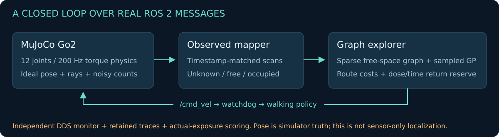

# Simulation architecture and method

[Project home](../README.md) · [Results](RESULTS.md) · [Hardware boundary](HARDWARE_STATUS.md)



## Source responsibility

| File in `src/go2_occmap/go2_occmap/` | Role |
|---|---|
| `assets.py`, `assets.json` | Public immutable asset URLs and checksum verification |
| `physics.py` | Scene construction, policy contract, joint torques, ideal rays and evaluator-only truth functions |
| `control.py` | Command watchdog and forward scan-stop gate |
| `sim_node.py` | Physics loop, observation publication, count simulation and recorded state |
| `mapping.py` | ROS-independent occupancy integration, graph, bounded GP and follower |
| `map_node.py` | Timestamp matching, observed map publication and map snapshots |
| `explore_node.py` | Goal admission, graph search, return logic, velocity command and trace |
| `monitor_node.py` | Independent subscriptions for live DDS contract checks |

The mapper/explorer import observation-processing utilities, not the simulator's
source coordinates or ground-truth occupancy. The map's 10 × 8 m extent and 0.1 m
resolution are fixed configuration. Obstacles and source values are not provided
as navigation maps. Hidden geometry is used only for physics, ray observations
and post-run coverage scoring.

## Physics and sensing

The Go2 model and pretrained `robot_lab` policy are pinned public upstream assets.
The policy input has 45 values: scaled body angular velocity, projected gravity,
three command components, twelve joint-position offsets, twelve scaled joint
velocities and twelve previous actions. Named joints explicitly map the policy's
FR/FL/RR/RL order to MuJoCo addresses.

At 50 Hz, policy actions become joint-position targets using the upstream
per-joint action scales. PD torques (`kp=20`, `kd=0.5`) are limited to ±23.5 Nm;
MuJoCo integrates at 200 Hz. The floating base is initialized once at `(-2, 0)`.
It is not reset, tethered or driven by planar pose commands during execution.

The ideal horizontal scanner has 180 rays, a 3.5 m maximum range and 10 Hz
simulated-time publication. Odometry is exact simulator pose projected to XY/yaw.
It is not an SLLIDAR S2 or Go2 L1 fidelity model. The occupancy mapper has no
scan-matching or loop-closure estimator and should not be described as sensor-only SLAM.

The IMU publishes MuJoCo sensor values in `base_link`; joint states include
position, velocity and applied control torque. A basic forward-stop gate
suppresses positive forward velocity if a front ray is within 0.7 m. It does
not provide all-direction collision prediction.

## Occupancy and sparse graph

Scans are paired with the nearest retained odometry timestamp within 25 ms.
Ray cells update a log-odds grid; unobserved cells remain unknown. Free-space
updates reduce log odds and endpoint hits increase them. This is a small 2-D
reference mapper for static scenes. Mapping discretization can label a small
number of ground-truth occupied cells free; coverage scoring excludes those cells.

The graph builder:

1. Computes Euclidean distance to non-free cells, including unknown cells.
2. Keeps a 0.60 m nominal clearance mask.
3. Samples safe nodes on a 0.4 m lattice.
4. Adds horizontal, vertical and diagonal neighbour edges only when the entire
   checked grid segment is safe.
5. Attaches the current pose and home to checked nearby graph nodes.

For local reconnection after walking-policy drift, the current pose may attach
through observed free cells with at least 0.50 m clearance. The attachment segment
must not decrease starting clearance by more than 0.02 m. The global graph mask
and edge checks keep the nominal 0.60 m requirement. A regression test exercises
this case and rejects reconnection through unknown or too-close cells.

Candidate utility uses nearby unknown-cell density divided by accumulated route
cost. Previously visited neighbourhoods are excluded. A current goal is retained
while valid to reduce goal switching. Dijkstra search uses edge costs
`length × (1 + radiation_weight × mean_endpoint_upper_rate / 20)`.

This regular-lattice abstraction is a new integration baseline; it is not a port
of the thesis's complete adaptive abstraction algorithm. No Nav2 action server
is used: a heading-first route follower publishes bounded velocity commands.

## Detector and field estimation

The simulator evaluates a synthetic field:

```text
rate(x) = 0.5 + Σ source_strength / (squared_distance(x, source) + 0.5)
actual_dose += rate(actual_robot_position) × physics_dt / 3600
counts ~ Poisson(integrated_rate × 50,000 counts/µSv / 3600)
```

Counts are emitted every 0.5 simulated seconds. The rate estimate is count-derived;
the observation is associated with the robot's position at the end of that
window. Ground truth is separately integrated for evaluation. Source strengths,
locations and dose units are illustrative, without shielding, scattering,
detector-energy response or electronics-damage calibration.

`SampledField` retains at most 64 recent spatial samples. Samples within 0.2 m of
the last retained position update its log-rate value. A Matérn-3/2 kernel with
1.2 m lengthscale and a fixed noise term supplies log-Gaussian regression on this
bounded set. It refits at prediction time, rather than implementing an unbounded
GP or a sparse variational/Poisson-likelihood algorithm.

The pointwise upper rate is `exp(log_mean + 2 × log_std)`. This is an approximate
model output, not a calibrated simultaneous confidence bound. Unseen locations
return toward the configured prior rather than receiving hidden-field values.

## Return and motion gating

Outbound and home-route exposure estimates integrate upper rates along graph
edges with a 0.12 m/s travel assumption. Admission includes the current measured
dose, both routes, a five-second dwell allowance and a 15% budget reserve.
A return-time estimate includes an eight-second allowance. Reaching 80% of the
dose budget or the return-time threshold switches the mission to returning.

Home completion requires the robot to be within 0.35 m; the scorer independently
checks a final distance below 0.4 m. The simulator exits on the returned status.
If no valid attachment or return route exists, the planner publishes a wait/reason
record and commands zero. After four simulated seconds without a supported motion
route, it emits a terminal failure and the simulator exits. This prevents a long
unchecked zero-command drift episode. A mission may still fail its deadline,
contacts or dose budget; the exit does not guarantee collision-free recovery.

Observations older than 1.5 wall-clock seconds gate explorer motion. The simulator
also applies a 0.5-second wall-clock command watchdog. Neither mechanism pins the
base: the walking policy can drift under zero command.

## ROS contract

| Topic | Type | Nominal simulated-time rate / notes |
|---|---|---|
| `/clock` | `rosgraph_msgs/Clock` | 50 Hz |
| `/odom` | `nav_msgs/Odometry` | 50 Hz; ideal XY/yaw in `odom` |
| `/tf` | `tf2_msgs/TFMessage` | `odom → base_footprint`, `base_footprint → laser`, `odom → base_link` |
| `/tf_static` | `tf2_msgs/TFMessage` | Identity `map → odom` |
| `/joint_states` | `sensor_msgs/JointState` | 50 Hz, twelve named joints |
| `/imu` | `sensor_msgs/Imu` | 50 Hz, MuJoCo sensor data in `base_link` |
| `/scan` | `sensor_msgs/LaserScan` | 10 Hz, in `laser` |
| `/map` | `nav_msgs/OccupancyGrid` | Up to 10 Hz, transient-local durability, in `map` |
| `/radiation/measurement` | `std_msgs/Float64MultiArray` | 2 Hz: `[sim_time_s, x_m, y_m, rate_usv_h, measured_dose_usv]` |
| `/abstraction/graph` | `visualization_msgs/MarkerArray` | Successful planning updates; nominal 1 Hz |
| `/plan` | `nav_msgs/Path` | Successful planning updates, in `map` |
| `/mission/status` | `std_msgs/String` | JSON decision or wait state |
| `/cmd_vel` | `geometry_msgs/Twist` | Nominal 10 Hz from the explorer |

The independent monitor checks topic receipt plus specified joint, scan, map,
measurement, command and status shape/value contracts. Receipt of a topic alone
does not certify every semantic property of its messages.

## Interpretation limits

The current evidence concerns flat-floor simulated locomotion, observed 2-D
mapping and a small static radiation field. It does not establish calibrated
radiation safety, sensor-only localization, full environmental coverage,
industrial stairs, dynamic-crowd avoidance or hardware deployment. Seeds change
detector noise; scheduler timing can also change trajectories, even at the same seed.
